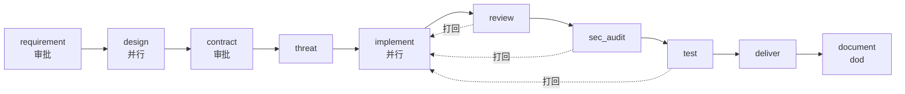
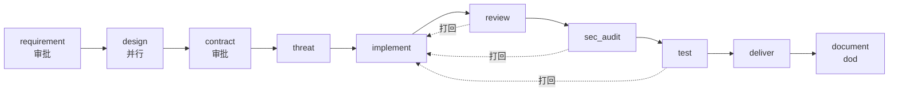
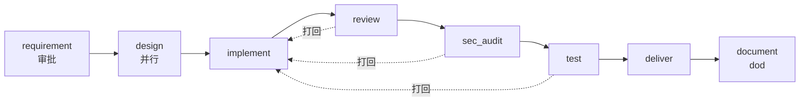
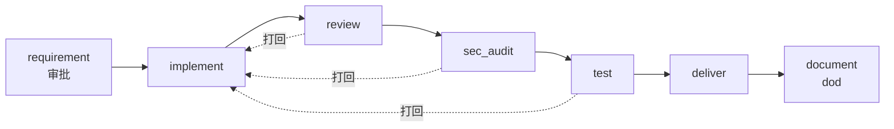
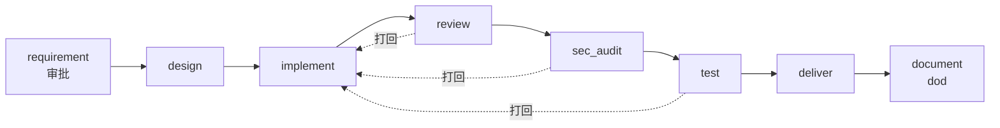

# 角色与流水线规格（Roles & Pipelines）

> **本文件从 `src/domain/` 派生，不由方案文档手抄。** 下面每一张表都来自已冻结的领域层：
> `src/domain/roles.ts` / `task-types.ts` / `pipeline.ts` / `router.ts` / `gates.ts` / `dod.ts`。
> 如与 `DSH-CodeFactory-插件实施方案.md` 第 1.2 节（原型规格）不一致，以**代码为准**，
> 差异逐条记录在第 7 节。
>
> 自检口径（`src/domain` 的实际计数，见本文件末尾第 8 节）：规范岗位 **12** 个、附加岗位 3 个、
> 原型 id 映射 **12** 条、其它可接受写法 39 条、流水线模板 **5** 套（阶段数 10 / 10 / 8 / 7 / 8）、
> 任务类型 **5** 族、DoD **7** 条；`validateRoleRegistry` / `validateTaskTypes` /
> `validateAllPipelines` / `validateDodItems` 全部 `ok: true` 且零告警。

---

## 1. 角色注册表（12 个岗位）

规范 id 即 `src/domain/roles.ts` 里的 `id`，也是成员邮箱文件名、成员名的取值。

| # | 规范 id | 中文名 | 代号 | 档位 | 分类色 | 职责 | 工件白名单（`outputs`） | 铁律条数 |
|---|---|---|---|---|---|---|---|---|
| 1 | `router` | 调度官 | ROUTER | chat | `#22d3ee` | 任务分类 · 动态组队 · 流程模板加载。这是队长的调度帽，不产生工件。 | —（不写工件） | 3 |
| 2 | `pm` | 产品经理 | PM | chat | `#60a5fa` | 需求澄清 · PRD 撰写 · 验收标准（Given/When/Then）。不做技术选型、不写代码。 | `PRD.md` | 3 |
| 3 | `ui_designer` | UI/UX 设计负责人 | UI | reasoner | `#e879f9` | 视觉体系 · 交互流程 · 行业与用户研究 · 配色与设计令牌 · 高保真与设计验收。只产出设计文档。 | `UI_SPEC.md` | 7 |
| 4 | `sys_arch` | 系统架构师 | ARCH | reasoner | `#a78bfa` | 技术选型 · 模块划分 · 架构设计。只在 PRD 与设计文档之上工作。 | `ARCHITECTURE.md` | 2 |
| 5 | `db_arch` | 数据库架构师 | DBA | reasoner | `#818cf8` | ER 设计 · 索引策略 · 迁移脚本。migration 必须真实执行验证。 | `DB_DESIGN.md`、`migrations/` | 2 |
| 6 | `api_designer` | API设计师 | API | chat | `#38bdf8` | 接口契约 · 字段级 Schema · 错误码。契约冻结后任何变更需走变更上报。 | `API_CONTRACT.md` | 2 |
| 7 | `security_eng` | 安全工程师 | SEC | reasoner | `#fbbf24` | 威胁建模 · 代码安全审计 · 持有一票否决权。只打回，不改代码。 | `THREAT_MODEL.md`、`SECURITY_AUDIT.md` | 3 |
| 8 | `fe_dev` | 前端工程师 | FE | reasoner | `#34d399` | 页面组件实现 · 按 UI 稿与 API 契约开发 · 构建自检。 | `src/frontend/` | 3 |
| 9 | `be_dev` | 后端工程师 | BE | reasoner | `#2dd4bf` | 业务逻辑 · 接口实现 · 冒烟验证。按契约与数据库设计实现。 | `src/backend/` | 3 |
| 10 | `reviewer` | 代码评审员 | CR | reasoner | `#fb923c` | 逐文件 Review · 阻塞级/建议级分级 · 结论只输出 APPROVED / REJECTED。 | `REVIEW.md` | 3 |
| 11 | `qa` | 测试工程师 | QA | reasoner | `#f87171` | 用例设计 · 测试实测 · Bug 按 P0/P1/P2 分级 · 验收标准逐条映射。 | `tests/`、`TEST_REPORT.md` | 3 |
| 12 | `devops` | DevOps | OPS | chat | `#94a3b8` | 构建打包 · 启动脚本 · README/DELIVERY · 版本 tag。只在测试通过后工作。 | `Dockerfile`、`start.sh`、`DELIVERY.md`、`README.md`、`docs/` | 3 |

说明：

- **档位（`tier`）是建议档位**，只用于成员启动时的模型路由快照（`AgentOptions.model`），不是硬约束。
- **分类色是插件自有色板**（原型色值），**不得**当作语义状态色使用；状态一律走 DSH 主题 token `--dsw-alias-state-*`。
- **工件白名单是审计依据，不是写入拦截**：DSH 无法拦文件写入，越界写入在 DoD 审计阶段判失败（见
  [architecture.md](architecture.md) 第 7 节）。
- **`router` 永远是队长的调度帽，不会成为成员**：`assembleTeam` 在任何编制里都会忽略它。它出现在注册表里
  是为了让驾驶舱渲染原型 12 行的第一行，并让 "调度官" 这类说法能被解析。
- 每个角色的成员人设由 `roles.ts` 的 `persona()` 从同一组字段渲染（职责 / 工件边界 / 铁律 / 协作协议），
  因此**驾驶舱看到的职责与成员读到的人设不可能不一致**。

### 1.1 附加岗位（不在规范 12 个之内）

这 3 个岗位**不会**被路由器自动编入队伍；它们存在的原因是：编制裁剪有明确顺序（它们排在最前面被裁），
以及 `factory_edit_plan` 允许给运行中的工厂加一位专员。

| 规范 id | 中文名 | 代号 | 档位 | 分类色 | 职责 | 工件白名单 | 铁律条数 |
|---|---|---|---|---|---|---|---|
| `perf` | 性能工程师 | PERF | reasoner | `#a3e635` | 压测 · 性能剖析 · 容量评估。只出报告与补丁建议。 | `PERF_REPORT.md` | 2 |
| `po` | 产品负责人 | PO | chat | `#f0abfc` | 范围裁剪 · 优先级排序 · 商业价值判断。 | `BACKLOG.md` | 2 |
| `tech_writer` | 技术文档工程师 | DOC | chat | `#7dd3fc` | README · API 文档 · 交付说明。档案面与 devops 重叠，二者不并行。 | `README.md`、`docs/` | 2 |

### 1.2 前端细分岗位（`SPECIALIST_ROLES`，自动指派，不在规范 12 个之内）

`web_fullstack` 模板里的 `fe_dev` 是一个**槽位**：`router.assembleTeam` 按 brief 的平台信号把它
替换成下列三个 specialist 之一；`fe_dev` 保留为「无法判定平台 / 旧数据」的通用回退。三者都注册进
`ALL_ROLE_BY_ID`（12 规范 + 3 附加 + 3 specialist = 18），但 `ROLE_IDS` / `CANONICAL_ROLE_COUNT`
仍是 12，`PROTOTYPE_ROLE_ID_ALIASES` 不变。

| 规范 id | 中文名 | 代号 | 分类色 | 平台信号示例 | 职责 | 工件白名单 |
|---|---|---|---|---|---|---|
| `web_dev` | Web前端工程师 | WEB | `#10b981` | web / 网页 / 前端 / 页面 / React / Vue | 页面与组件实现 · 响应式与构建自检 | `src/frontend/` |
| `flutter_dev` | Flutter工程师 | FT | `#06b6d4` | flutter / dart / 移动端 Flutter | Dart/Widget 实现 · 平台通道 · analyze/test | `lib/`、`test/` |
| `mini_program_dev` | 小程序工程师 | MP | `#ec4899` | 小程序 / 微信 / uni-app / Taro / weapp | 小程序页面组件 · 包体积 · 真机自检 | `miniprogram/` |

别名：`web_frontend`/`webdev`/`web前端工程师` → `web_dev`；`flutter`/`dart`/`dart_dev` → `flutter_dev`；
`mini_program`/`miniprogram`/`weapp`/`wechat_mini`/`mp_dev`/`小程序`/`小程序工程师` → `mini_program_dev`。
`fe_dev`/`frontend_dev`/`前端工程师` 仍解析到通用 `fe_dev`。

---

## 2. id 别名与原型对照

### 2.1 原型 id → 规范 id（`PROTOTYPE_ROLE_ID_ALIASES`，12 条全覆盖）

| 原型 §1.2 表中的 id | 本注册表的规范 id | 是否一致 |
|---|---|---|
| `router` | `router` | 相同 |
| `pm` | `pm` | 相同 |
| `ui_designer` | `ui_designer` | 相同 |
| `sys_arch` | `sys_arch` | 相同 |
| `db_arch` | `db_arch` | 相同 |
| `api_designer` | `api_designer` | 相同 |
| `sec_eng` | `security_eng` | **不同**（见第 7 节差异 1） |
| `fe_dev` | `fe_dev` | 相同 |
| `be_dev` | `be_dev` | 相同 |
| `reviewer` | `reviewer` | 相同 |
| `qa` | `qa` | 相同 |
| `devops` | `devops` | 相同 |

### 2.2 其它可接受写法（`ROLE_ALIASES`，输入侧兼容）

`canonicalRoleId()` 会统一做小写 + 去空白 + 别名解析，因此以下写法都能用（工具参数、邮件收件人、计划编辑）：

| 写法 | 解析为 | | 写法 | 解析为 |
|---|---|---|---|---|
| `sec_eng` | `security_eng` | | `ui` | `ui_designer` |
| `security` | `security_eng` | | `arch` | `sys_arch` |
| `architect` | `sys_arch` | | `dba` | `db_arch` |
| `sys_architect` | `sys_arch` | | `sec` | `security_eng` |
| `db_architect` | `db_arch` | | `fe` | `fe_dev` |
| `frontend_dev` | `fe_dev` | | `be` | `be_dev` |
| `backend_dev` | `be_dev` | | `cr` | `reviewer` |
| `coder` | `be_dev` | | `qa_eng` | `qa` |
| `api` | `api_designer` | | `调度官` | `router` |
| `code_reviewer` | `reviewer` | | `产品经理` | `pm` |
| `ops` | `devops` | | `ui设计师` | `ui_designer` |
| `devops_engineer` | `devops` | | `系统架构师` | `sys_arch` |
| `doc` / `doc_writer` | `tech_writer` | | `数据库架构师` | `db_arch` |
| `performance` / `perf_eng` | `perf` | | `api设计师` | `api_designer` |
| `product_owner` | `po` | | `安全工程师` | `security_eng` |
| | | | `前端工程师` / `后端工程师` | `fe_dev` / `be_dev` |
| | | | `代码评审员` / `测试工程师` | `reviewer` / `qa` |
| | | | `技术文档工程师` / `性能工程师` / `产品负责人` | `tech_writer` / `perf` / `po` |

---

## 3. 任务类型 → 流水线映射（5 族）

路由打分 = 命中的关键词个数；并列时取注册表里靠前的一族；一个都没命中则回退到
**注册表最后一项** `script_tool`（最省流水线）。

| 任务类型 | 名称 | 关键词 | 默认编制（建议入队顺序） | 流水线 |
|---|---|---|---|---|
| `web_fullstack` | Web 全栈应用 | 网站 / 网页 / web / 前端 / 页面 / 小程序 / 后台管理 / 管理后台 / 全栈 / fullstack / 电商 / 商城 / dashboard / 控制台 | `pm`、`ui_designer`、`sys_arch`、`db_arch`、`api_designer`、`security_eng`、`fe_dev`、`be_dev`、`reviewer`、`qa`、`devops`（11） | `fullstack` |
| `api_only` | 后端 API 服务 | api / 接口 / 后端服务 / 微服务 / restful / 服务端 / 后端 / endpoint / sdk | `pm`、`sys_arch`、`api_designer`、`db_arch`、`security_eng`、`be_dev`、`reviewer`、`qa`、`devops`（9） | `api` |
| `data_pipeline` | 数据管道 | 爬虫 / etl / 数据清洗 / 数据采集 / 数据处理 / 数据管道 / 数据同步 / 数据仓库 / 报表 / 数据源 / 批量导入 | `pm`、`sys_arch`、`db_arch`、`be_dev`、`reviewer`、`qa`、`devops`（7） | `data` |
| `ml_model` | 机器学习模型 | 模型 / 训练 / 机器学习 / 深度学习 / 神经网络 / 推荐算法 / 预测 / 微调 / llm / 推理服务 / embedding / rag / 特征工程 | `pm`、`sys_arch`、`be_dev`、`reviewer`、`qa`、`devops`（6） | `ml` |
| `script_tool` | 脚本 / 工具 | 脚本 / 小工具 / 工具 / 自动化 / cli / 命令行 / 批处理 / 定时任务 / rename / 转换器 | `pm`、`be_dev`、`reviewer`、`qa`、`devops`（5） | `lightweight` |

> 默认编制是**起点**，不是承诺：`assembleTeam` 会先补齐铁三角、按安全触发加入 `security_eng`，
> 再按上限裁剪（见第 4 节）。

---

## 4. 组队规则（`src/domain/router.ts`）

### 4.1 铁三角（任何编制都必须满足）

- 必须有 `pm`（需求角）+ `qa`（验收角）+ **至少一名 `*_dev`**（实现角）。
- 任务类型表漏了谁，路由器就补谁，并在 `reasoning` 里写明（`铁三角补位：be_dev`）。
- **铁三角不可被上限裁剪**：`pm` / `qa` 永远 pin；最后一个 `*_dev` 也永远不裁。
- 硬地板：`MIN_TEAM_SIZE = 3`；安全触发时地板为 4（见 4.2）。`cap` 低于地板时返回 `overCap`
  并在 `reasoning` 里说明，而不是把铁三角裁散。

### 4.2 安全岗触发（78 个关键词）

规格给定的 7 个排在最前（顺序固定，`SECURITY_TRIGGERS.slice(0, 7)`）：

> **登录 / 鉴权 / 用户数据 / 支付 / 密码 / token / 对外**

其余 71 个分三组追加，顺序稳定、由 `scripts/verify.mjs` 的 A6 **逐词**断言：

- **机制同义词（15）**：`认证`、`授权`、`权限`、`越权`、`隐私`、`敏感数据`、`加密`、`密钥`、
  `jwt`、`oauth`、`session`、`signin`、`signup`、`password`、`credit card`
- **身份（22）**：`注册`、`账号`、`账户`、`会员`、`实名`、`身份证`、`手机号`、`手机`、`短信`、
  `验证码`、`收货地址`、`地址`、`openid`、`微信`、`小程序`、`公众号`、`支付宝`、`人脸`、`指纹`、
  `第三方登录`、`单点登录`、`sso`
- **钱（14）**：`订单`、`退款`、`结算`、`提现`、`钱包`、`余额`、`优惠券`、`发票`、`计费`、`收费`、
  `押金`、`打赏`、`佣金`、`订阅`
- **敏感领域（20）**：`医疗`、`病历`、`健康`、`药品`、`银行`、`金融`、`信贷`、`保险`、`征信`、
  `学生`、`学籍`、`未成年人`、`位置`、`定位`、`轨迹`、`摄像头`、`监控`、`录音`、`跑腿`、`骑手`

命中任意一个 → `securityTriggered = true`，并**强制**把 `security_eng` 加入编制且 **pin 住不可裁剪**
（即使 `cap` 只有 4，也会得到 `pm + qa + 一名 dev + security_eng`）。

#### 为什么从 22 个词加到 78 个（H4）

原来的表只覆盖**机制**：一个 brief 如果说的是**生意**而不是机制，就会一个词都不命中。
真实事故：用户工厂 `25601bb2` 的 brief 是「做一个跑腿的微信小程序」，`securityTriggered`
被记成 `false`，于是 DoD 第 4 条（`securityOnly`）自动记为通过，理由是「本次工厂未触发安全路径」——
而这个应用有微信登录、有骑手和客户的手机号、有收货地址、有支付。**结论是错的，且错在会跳过审计的那一侧。**

不对称性决定了取舍：**漏判**会静默地把安全路径判为不适用，**误判**只是一名 `security_eng`
（每个模板本来就列了这个岗，路由器 pin 住但从不给它造活）加一个 `threat` 阶段
（每条 fullstack 流水线本来就带）。所以词表往「宁可触发」一侧偏。

同口径的负向控制写在 A6 里：`把首页配色改成蓝色`、`做一个公司介绍的单页应用`、
`写一个把 Markdown 转成 PDF 的命令行工具`、`给现有的日志加一个轮转策略`，以及
`FAMILY_BRIEFS` 的全部五个家族 brief，**都必须不触发**——一个见谁都触发的词表和漏判是同一种缺陷。

#### 触发是动态结论，不是一次性判定

计划期的 brief 只有一句话，所以它给出的判定只是**第一猜**；PRD 正文才写机制。
**每次门禁**都会用 `securitySignalForDocuments(brief, [流水线上声明的全部工件正文])` 复评
（所以需求阶段那个 `humanApproval` 点就是第一次能读到 PRD 正文的机会），判定结果带上来源：

- `source: 'brief'` —— 计划期就触发了；
- `source: 'document'` —— 只有后续文档触发（PRD 里写了手机号/收货地址/支付）；
- `source: 'none'` —— 都没触发。

**只升不降**：路径一旦生效，工厂已经配好并 pin 住了 `security_eng`、跑过 `threat` 阶段、
不再跳过 `securityOnly` 的 DoD 条目；后续文档即使不再提触发词也**不能**把这些撤销，
降级只会静默地重跳一次已经记录在案的审计。所以并集只增不减。
`TeamDecision` 会把 `securityHits` 与 `securitySource` 一并带出来，计划里能看到这个词是从哪来的。

匹配细节（都在纯函数里，可离线断言）：

- 中文触发词按子串匹配（中文没有词边界）。
- 纯 ASCII 触发词按**词边界**匹配，所以 `实现一个 tokenizer` **不会**误触发，`用 token 做鉴权` 会。
- **不做否定分析**：`写个脚本，不需要鉴权` 一样会触发。宁可多派一名安全工程师，也不漏掉一次鉴权。

### 4.3 编制上限与裁剪顺序

- 默认上限 `DEFAULT_MAX_MEMBERS = MAX_TEMPLATE_ROSTER`（= 最宽模板的编制长度，当前 11；
  对应配置项 `maxMembers`）。**它是算出来的，不是写死的**：写死的 8 会把 `web_fullstack`
  需要的 `ui_designer` / `sys_arch` / `db_arch` 悄悄裁掉，再让 `ROLE_FALLBACKS` 把设计阶段
  交还给它自己的实现者（H3）。模板变宽，默认值自动跟上。
  工具参数会被 `sanitizeCap()` 兜底：非有限数→默认值，小数→向下取整，负数→1。
- 超限时按固定顺序从左到右裁剪，先命中先裁：

  > `perf` → `po` → `tech_writer` → `ui_designer` → `db_arch` → `sys_arch` → `api_designer`
  > → `reviewer` → `devops` → `security_eng` → `web_dev` → `flutter_dev` → `mini_program_dev`
  > → `fe_dev` → `be_dev`

  前三个是规格指定的优先级（`perf > po > tech_writer`）；接着是职责可被保留角色吸收的设计类专员；
  最后才是实现类，并且**永远保留最后一名 `*_dev`**。
  安全触发时 `security_eng` 不在可裁序列内（被 pin）。

  例：`web_fullstack` 默认 11 人 → cap 8 时裁掉 `ui_designer`、`db_arch`、`sys_arch`，保留
  `pm, api_designer, security_eng, web_dev, be_dev, reviewer, qa, devops`（平台不同则替换为对应的
  specialist；`required` 用的是替换后的 team，所以被裁 specialist 会如实进 `trimmedRequired`）。

### 4.4 替补阶梯（`ROLE_FALLBACKS`）

裁剪（或任务类型本身没配某角色）会留下"阶段无人"的洞。`pipeline.resolveStageRoles()` 会在
**实际编制**上解析每个阶段：优先用本角色；否则沿替补阶梯取第一个在编的人；都没有才算 `missing`
（引擎必须升级人工）。同一阶段内优先选没被占用的人，实在没人可复用时允许一人多角。

| 缺失角色 | 替补顺序 |
|---|---|
| `ui_designer` | `web_dev` → `flutter_dev` → `mini_program_dev` → `fe_dev` → `pm` |
| `sys_arch` | `be_dev` → `pm` |
| `db_arch` | `be_dev` → `sys_arch` → `pm` |
| `api_designer` | `sys_arch` → `be_dev` → `pm` |
| `fe_dev` | `web_dev` → `flutter_dev` → `mini_program_dev` → `be_dev` |
| `web_dev` / `flutter_dev` / `mini_program_dev` | `fe_dev` → `be_dev` |
| `be_dev` | `web_dev` → `flutter_dev` → `mini_program_dev` → `fe_dev` |
| `reviewer` | `qa` → `pm` |
| `security_eng` | `reviewer` → `qa` |
| `qa` | `reviewer` |
| `devops` | `be_dev` → `pm` |
| `perf` | `reviewer` |
| `po` | `pm` |
| `tech_writer` | `devops` → `pm` |
| `pm` / `router` | —（只允许本人；`pm` 永远在编） |

因此**每套模板的每个阶段在默认编制下、以及裁剪到 cap=8 之后，都仍然有执行人**——这是领域层
可离线断言的不变量（见第 8 节自检）。

---

## 5. 流水线模板（5 套）

图例：`并行` = 多角色同时开工；`审批` = 需要人类确认（`humanApproval`）；`R n` = `maxRounds`；
虚线 = `failGoto` 打回（只能回退，不能前进）。**阶段顺序不可跳**：`validatePipeline` 会拒绝
任何 `failGoto` 指向自身或更晚阶段的模板。

### 5.1 `fullstack` —— Web 全栈（10 阶段，原型的完整流水线）

| # | stage id | 名称 | 参与角色 | 并行 | 人工审批 | 门禁类型 | maxRounds | failGoto |
|---|---|---|---|---|---|---|---|---|
| 1 | `requirement` | 需求分析 | `pm` | — | ✅ | checklist | 2 | — |
| 2 | `design` | 并行设计 | `ui_designer`、`sys_arch`、`db_arch` | ✅ | — | composite | 2 | — |
| 3 | `contract` | API 契约冻结 | `api_designer` | — | ✅ | checklist | 2 | — |
| 4 | `threat` | 威胁建模 | `security_eng` | — | — | checklist | 1 | — |
| 5 | `implement` | 并行开发 | `fe_dev`、`be_dev` | ✅ | — | script | 3 | — |
| 6 | `review` | 代码评审 | `reviewer` | — | — | keyword | 3 | `implement` |
| 7 | `sec_audit` | 安全审计 | `security_eng` | — | — | keyword | 3 | `implement` |
| 8 | `test` | 测试验证 | `qa` | — | — | composite | 3 | `implement` |
| 9 | `deliver` | 构建交付 | `devops` | — | — | script | 2 | — |
| 10 | `document` | 文档与总验收 | `devops` | — | — | dod | 2 | — |



门禁细则：

| 阶段 | 门禁要求（不通过就打回/原地重试） |
|---|---|
| `requirement` | `PRD.md` 含 6 个标题：背景与目标、用户故事、功能清单、验收标准、非目标、待确认问题 |
| `design` | `UI_SPEC.md`（页面清单/交互流程/设计规范）∧ `ARCHITECTURE.md`（技术选型/模块划分/接口清单）∧ `DB_DESIGN.md`（ER 设计/索引策略/迁移脚本） |
| `contract` | `API_CONTRACT.md` 含 接口清单、字段级 Schema、错误码 |
| `threat` | `THREAT_MODEL.md` 含 STRIDE、威胁清单、缓解措施 |
| `implement` | 脚本退出码 0：`npm run build --if-present`（JS/TS 栈；无 build 脚本视为通过，绝无误判失败） |
| `review` | `REVIEW.md` **最后一条**结论为 `结论: APPROVED`（`结论: REJECTED` 即打回 `implement`） |
| `sec_audit` | `SECURITY_AUDIT.md` 最后结论为 `结论: SEC_PASS`（`结论: SEC_FAIL` 打回 `implement`，安全工程师有一票否决权） |
| `test` | `TEST_REPORT.md` 最后结论 `结论: PASS` **∧** 真实执行 `python -m pytest -q` 退出码 0 —— 文本声明无法绕过 |
| `deliver` | `bash start.sh --check` 退出码 0 |
| `document` | `dod` 总验收（7 条）+ `README.md` 含 简介/安装/启动/接口一览 |

### 5.2 `api` —— 后端 API 服务（10 阶段）

| # | stage id | 名称 | 参与角色 | 并行 | 人工审批 | 门禁类型 | maxRounds | failGoto |
|---|---|---|---|---|---|---|---|---|
| 1 | `requirement` | 需求分析 | `pm` | — | ✅ | checklist | 2 | — |
| 2 | `design` | 并行设计 | `sys_arch`、`db_arch` | ✅ | — | composite | 2 | — |
| 3 | `contract` | API 契约冻结 | `api_designer` | — | ✅ | checklist | 2 | — |
| 4 | `threat` | 威胁建模 | `security_eng` | — | — | checklist | 1 | — |
| 5 | `implement` | 接口实现 | `be_dev` | — | — | script | 3 | — |
| 6 | `review` | 代码评审 | `reviewer` | — | — | keyword | 3 | `implement` |
| 7 | `sec_audit` | 安全审计 | `security_eng` | — | — | keyword | 3 | `implement` |
| 8 | `test` | 测试验证 | `qa` | — | — | composite | 3 | `implement` |
| 9 | `deliver` | 构建交付 | `devops` | — | — | script | 2 | — |
| 10 | `document` | 文档与总验收 | `devops` | — | — | dod | 2 | — |



门禁细则：`requirement` / `contract` / `threat` / `review` / `sec_audit` / `test` / `deliver` /
`document` 与 `fullstack` 相同；差异在

| 阶段 | 门禁要求 |
|---|---|
| `design` | `ARCHITECTURE.md`（技术选型/模块划分/接口清单）∧ `DB_DESIGN.md`（ER 设计/索引策略/迁移脚本）—— 没有 UI 产物 |
| `implement` | 脚本退出码 0：`python -m compileall -q src`（Python 服务栈） |

### 5.3 `data` —— 数据管道（8 阶段）

| # | stage id | 名称 | 参与角色 | 并行 | 人工审批 | 门禁类型 | maxRounds | failGoto |
|---|---|---|---|---|---|---|---|---|
| 1 | `requirement` | 需求与数据源分析 | `pm` | — | ✅ | checklist | 2 | — |
| 2 | `design` | 并行设计 | `sys_arch`、`db_arch` | ✅ | — | composite | 2 | — |
| 3 | `implement` | 管道实现 | `be_dev` | — | — | script | 3 | — |
| 4 | `review` | 代码评审 | `reviewer` | — | — | keyword | 3 | `implement` |
| 5 | `sec_audit` | 安全审计 | `security_eng` | — | — | keyword | 2 | `implement` |
| 6 | `test` | 测试验证 | `qa` | — | — | composite | 3 | `implement` |
| 7 | `deliver` | 构建交付 | `devops` | — | — | script | 2 | — |
| 8 | `document` | 文档与总验收 | `devops` | — | — | dod | 2 | — |



门禁细则（差异部分）：`requirement` 要求 `PRD.md` 含 背景与目标、**数据源与字段映射**、处理流程、验收标准、非目标；
`design` 要求 `ARCHITECTURE.md`（技术选型/**数据流**/**调度策略**）∧ `DB_DESIGN.md`（ER 设计/索引策略）；
`implement` = `python -m compileall -q src`；`sec_audit` 为 `maxRounds: 2`；其余同上。

### 5.4 `lightweight` —— 脚本 / 工具（7 阶段）

| # | stage id | 名称 | 参与角色 | 并行 | 人工审批 | 门禁类型 | maxRounds | failGoto |
|---|---|---|---|---|---|---|---|---|
| 1 | `requirement` | 需求分析 | `pm` | — | ✅ | checklist | 2 | — |
| 2 | `implement` | 实现 | `be_dev` | — | — | script | 3 | — |
| 3 | `review` | 代码评审 | `reviewer` | — | — | keyword | 3 | `implement` |
| 4 | `sec_audit` | 安全审计 | `security_eng` | — | — | keyword | 2 | `implement` |
| 5 | `test` | 测试验证 | `qa` | — | — | composite | 3 | `implement` |
| 6 | `deliver` | 构建交付 | `devops` | — | — | script | 2 | — |
| 7 | `document` | 文档与总验收 | `devops` | — | — | dod | 2 | — |



门禁细则（差异部分）：`requirement` 只要求 `PRD.md` 含 功能清单 / 验收标准 / 非目标；
`implement` = `python -m compileall -q .`（目录级语法检查；非 Python 仓库无 `.py` 文件即通过）。

### 5.5 `ml` —— 机器学习模型（8 阶段）

| # | stage id | 名称 | 参与角色 | 并行 | 人工审批 | 门禁类型 | maxRounds | failGoto |
|---|---|---|---|---|---|---|---|---|
| 1 | `requirement` | 任务与指标定义 | `pm` | — | ✅ | checklist | 2 | — |
| 2 | `design` | 方案设计 | `sys_arch` | — | — | checklist | 2 | — |
| 3 | `implement` | 训练与推理实现 | `be_dev` | — | — | script | 3 | — |
| 4 | `review` | 代码评审 | `reviewer` | — | — | keyword | 3 | `implement` |
| 5 | `sec_audit` | 安全审计 | `security_eng` | — | — | keyword | 2 | `implement` |
| 6 | `test` | 评估验证 | `qa` | — | — | composite | 3 | `implement` |
| 7 | `deliver` | 构建交付 | `devops` | — | — | script | 2 | — |
| 8 | `document` | 文档与总验收 | `devops` | — | — | dod | 2 | — |



门禁细则（差异部分）：`requirement` 要求 `PRD.md` 含 业务目标 / 数据与特征 / 模型方案 / 评估指标 / 非目标；
`design` 单角色 `sys_arch`，要求 `ARCHITECTURE.md` 含 数据流 / 特征工程 / 训练与推理架构；
`implement` = `python -m compileall -q src`；`test` 阶段名为"评估验证"。

### 5.6 五套模板共用的门禁词汇（`src/domain/pipeline.ts` 常量）

| 常量 | 值 | 用途 |
|---|---|---|
| `TEST_COMMAND` | `python -m pytest -q` | `test` 阶段的脚本门禁 + DoD 第 2 条 |
| `DELIVERY_CHECK_COMMAND` | `bash start.sh --check` | `deliver` 阶段 + DoD 第 5 条 |
| `CONCLUSIONS.reviewPass` / `reviewFail` | `结论: APPROVED` / `结论: REJECTED` | `review` 门禁 |
| `CONCLUSIONS.secPass` / `secFail` | `结论: SEC_PASS` / `结论: SEC_FAIL` | `sec_audit` 门禁 |
| `CONCLUSIONS.testPass` / `testFail` | `结论: PASS` / `结论: FAIL` | `test` 门禁 |
| `ARTIFACTS.*` | `PRD.md`、`UI_SPEC.md`、`ARCHITECTURE.md`、`DB_DESIGN.md`、`API_CONTRACT.md`、`THREAT_MODEL.md`、`SECURITY_AUDIT.md`、`REVIEW.md`、`TEST_REPORT.md`、`README.md`、`DELIVERY.md`、`start.sh` | 全部工件路径的唯一出处 |

⚠️ **门禁命令只能来自这些模板**。`gates.ts` 的 `isSafeGateCommand()` 会拒绝带 `;`、`&&`、`|`、
重定向、命令替换或破坏性动词（`rm -rf` 等）的命令；模型**无权**指定要执行的命令。

### 5.7 门禁类型语义（`src/domain/gates.ts`）

| 类型 | 判定方式 | 谁来执行 |
|---|---|---|
| `checklist` | 工件里每个必备章节都要作为 **Markdown 标题**出现（容忍 `## 一、背景与目标` 这类前缀） | 纯函数（注入工件文本） |
| `keyword` | 扫描结论行，**最后一条**命中的为准；`passWord` 命中即过，`failWord` 命中即打回；两条都没有也判失败 | 纯函数（注入工件文本） |
| `script` | 退出码 0 才算过 | **运行时**执行（`needsExecution` + `pendingCommands` 交给 runtime） |
| `composite` | 子门禁**递归 AND**；任一子门禁确定失败即整体失败（此时不再要求执行）；否则若有子门禁待执行则整体 `needsExecution` | 纯函数组合 + 运行时补齐 |
| `dod` | 7 条 DoD 全过（可选再校验工件章节锚点） | 运行时提供 DoD 结果（`evaluateDod`） |

领域层**只做判定，不执行命令、不读磁盘**：没有读取器或执行结果时，返回 `needsExecution: true` +
`pendingCommands`，绝不用模型文本伪造通过。

---

## 6. DoD 七条（`src/domain/dod.ts`）

`document` 阶段的门禁即这 7 条；`factory_dod_check`（M5 落地）走同一套纯校验器。

| # | 条目 | 校验类型 | 工件 | 判据 | 安全路径专属 |
|---|---|---|---|---|---|
| 1 | PRD 验收标准与测试用例全映射通过 | `crossref` | `PRD.md` | PRD 里每条 `AC-n` 都要在 `TEST_REPORT.md` 出现（PRD 未编号 AC-n 直接失败） | — |
| 2 | pytest 实跑全绿（退出码 0） | `script` | `TEST_REPORT.md` | `python -m pytest -q` 退出码 0 | — |
| 3 | 代码评审 APPROVED · 无遗留阻塞级问题 | `keyword` | `REVIEW.md` | 最后结论命中 `APPROVED`（`REJECTED` 反判） | — |
| 4 | 安全审计 SEC_PASS | `keyword` | `SECURITY_AUDIT.md` | 最后结论命中 `SEC_PASS` | ✅ 未触发安全路径时跳过 |
| 5 | `start.sh --check` 退出码 0 | `script` | `start.sh` | `bash start.sh --check` 退出码 0 | — |
| 6 | README 含 简介/安装/启动/接口一览 | `file` | `README.md` | 文件存在，且 4 个标题都在 | — |
| 7 | git 逐阶段 commit · 版本 tag v1.0.0 | `git` | — | 存在 tag `v1.0.0`，且 commit 数 ≥ 阶段数（逐阶段提交） | — |

`evaluateDod({ readFile, executed, git, securityTriggered, minCommits })` 是纯函数：缺读取器 /
缺命令结果 / 缺 git 事实时返回 `needsExecution`，`summary.ok` 只在"零失败且零待执行"时为真。

---

## 7. 与原型方案（实施方案 §1.2）的差异记录

以代码为准，差异逐条列出（含原因）：

| # | 原型方案 | 代码实现 | 原因 |
|---|---|---|---|
| 1 | 安全工程师 id = `sec_eng` | 规范 id = `security_eng`；`sec_eng` 作为别名保留并在 `PROTOTYPE_ROLE_ID_ALIASES` 中显式记录 | 任务书的安全触发规则写的是 `security_eng`，且 `assembleTeam` 的返回编队必须能直接被字面断言命中。其余 11 个 id 与原型完全一致 |
| 2 | 原型流水线第 1 阶段是 `route`（路由组队，无门禁） | 模板从 `requirement` 开始，不含 `route`；路由是 `factory_plan` 的前置动作，产物写在 `factory.json` | `route` 不产生工件、无门禁、由队长自己完成，把它塞进阶段序列只会让"阶段顺序不可跳"出现一个无意义的空阶段 |
| 3 | 原型 10 阶段到 `deliver` 结束 | 增加了第 10 阶段 `document`（`devops`，`dod` 门禁 + README 4 标题锚点） | 原型把 README/交付文档挂在 DoD 第 6 条上却没人在流水线里负责它；补一个阶段让 DoD 有执行者 |
| 4 | `threat` 门禁 = keyword（"威胁建模完成"） | `checklist`：`THREAT_MODEL.md` 含 STRIDE / 威胁清单 / 缓解措施 | 自由文本结论词无法机器校验；章节清单是同类语义里可离线判定的最强形式 |
| 5 | `contract` 门禁 = `schema_check（字段级）` | `checklist`：`API_CONTRACT.md` 含 接口清单 / 字段级 Schema / 错误码 | 五类门禁（checklist/keyword/script/composite/dod）里没有 `schema_check`；字段级要求转化为章节清单 + 人工审批冻结 |
| 6 | 原型任务类型只有 4 族（无 `ml_model`） | 补齐 5 族（Kimi 骨架的 4 族 + `ml_model` + `ml` 模板） | 任务书要求 5 套模板全部实现；`ml_model` 若不注册就会错误路由到 `script_tool` |
| 7 | 原型"11 人编制"，未定义上限与裁剪序 | 上限默认 8，裁剪序 `perf > po > tech_writer > …`，铁三角与安全岗不可裁 | 任务书硬性要求；配合第 4.4 节替补阶梯保证阶段不会因此无人 |
| 8 | 原型阶段表没有 `maxRounds` 具体值（只有"打回 R 轮"图例） | `requirement`/`design`/`contract`/`document`/`deliver` = 2，`threat` = 1，`implement`/`review`/`test` = 3，`sec_audit` = 2~3 | 门禁失败容忍度必须落到数字上才能"超限升级人工"；返工成本高的阶段给 3 轮，纯校验阶段给 1–2 轮 |
| 9 | Kimi 骨架有 `tech_writer` 负责 README | README/DELIVERY 归 `devops`（规范 12 岗之一）；`tech_writer` 降为附加岗位（会被优先裁剪） | 规范 12 岗里没有 `tech_writer`；文档职责必须由**一定在编**的角色承担，否则 cap=8 时文档阶段无人 |
| 10 | 原型 artifacts 表把 `Dockerfile+start.sh` 与 `DELIVERY.md` 记在 devops 名下 | 一致；`devops.outputs` 额外包含 `README.md` 与 `docs/` | 见差异 9 |

另外这些**不是差异而是原型语义的加固**：`keyword` 门禁取"最后一条结论"（支持"先 REJECTED 后 APPROVED"
的复审报告）、`script` 门禁只认退出码、`composite` 是递归 AND、DoD 全部机器可校验（禁止模型文本当证据）。

---

## 8. 如何核对本文件（文档 ↔ 代码一致性）

本文件的表格与数字由**仓库里的检查器**强制同步（曾经因为检查器住在仓库外而漂移过一次——
**仓库外的检查等于不存在**）：

```bash
# 先构建（检查器比对的是编译产物 lib/domain，不是 src/）
pnpm build
# 一次跑完：表格逐字段比对 + 所有文档数字对照工具实测（verify 项数/分区、doctor 项数、脚本行数、注册表计数…）
node scripts/check-docs.mjs
```

检查器**能失败**：任何一处数字过时或表格字段不一致，都会以 `file:line` + 「写着 X，实际 Y」的形式报红；
数字口径与例外清单一律写在 `scripts/check-docs.mjs` 头部注释里。

不变量（每次改动领域层后都应重新成立）：

- `ROLES.length === 12`，`PROTOTYPE_ROLE_ID_ALIASES` 覆盖全部 12 个规范 id；
- `PIPELINE_IDS.length === 5`，阶段数分别为 `fullstack=10`、`api=10`、`data=8`、`lightweight=7`、`ml=8`；
- 每个阶段的 `failGoto`（若有）都指向同模板中**更早**的阶段；
- 每套模板的每个阶段在默认编制与 cap=8 编制下都有执行人（直接或替补）；
- `DOD_ITEMS.length === 7`，其中恰好 1 条 `securityOnly`。

> 上面的不变量**已经进了仓库里的离线验证**：`node scripts/verify.mjs`（等价于 `pnpm verify`）以
> 编译产物 `lib/domain` + `lib/store` + `lib/runtime` 为被测对象，跑 103 项检查 —— A 区路由组队、B 区流水线完整性
> （`failGoto` 回退、角色已注册、每阶段 `maxRounds`、门禁参数、阶段 staffing）、C 区门禁判定、
> D 区 DoD 七条、E 区 store 往返、F 区锁解除与串行化、G 区 harness 自检、H 区 stranded attempt 恢复
> 与执行者三态判据、I 区 planner 决策一致性（含随包发布的假宿主模型）。本次实测 **103/103 绿、exit 0**；
> 本文档的表格一致性由仓库里的 `node scripts/check-docs.mjs` 核对（逐字段比对 + 所有文档数字对照工具实测）。
